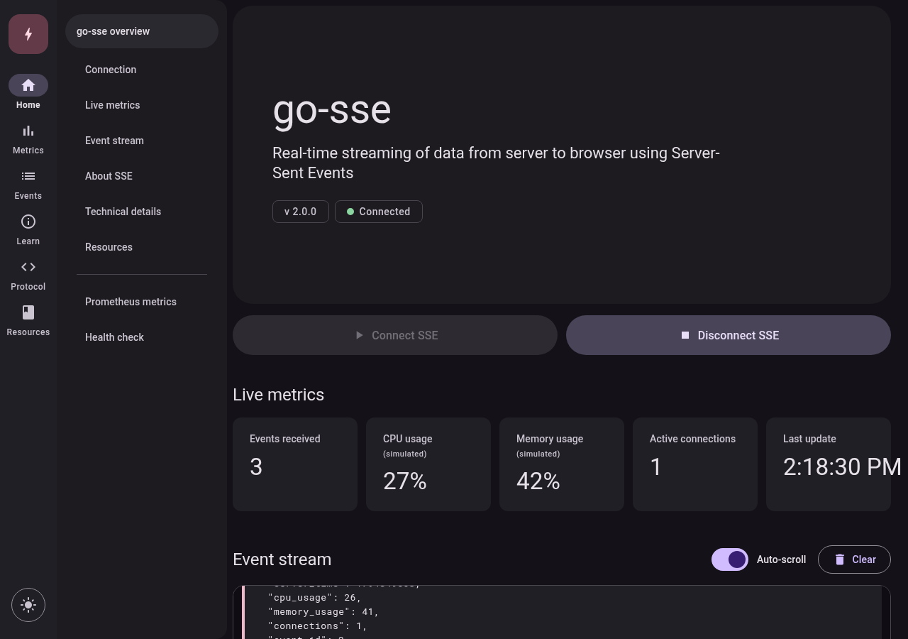
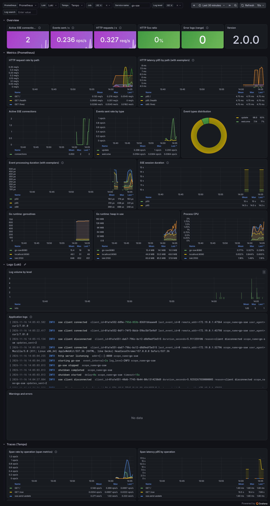

# go-sse

<!-- TOC -->

- [go-sse](#go-sse)
- [Introduction](#introduction)
- [Features](#features)
  - [API Endpoints](#api-endpoints)
  - [Metrics](#metrics)
- [Quick start](#quick-start)
  - [Prerequisites](#prerequisites)
  - [Full stack with Docker Compose](#full-stack-with-docker-compose)
  - [Single container](#single-container)
  - [Running locally without Docker](#running-locally-without-docker)
- [Configuration](#configuration)
- [Kubernetes (Helm 4)](#kubernetes-helm-4)
- [Build image](#build-image)
- [Documentation](#documentation)
- [Developer](#developer)
- [License](#license)

<!-- TOC -->

# Introduction

A web application for testing and demonstrating the **Server-Sent Events (SSE)** protocol using Golang, instrumented with **metrics, logs and traces**.

Server-Sent Events (SSE) is a lightweight, unidirectional protocol for streaming real-time text data from a server to a client over a single, long-lived HTTP connection. Using the `text/event-stream` format, it enables efficient server-to-browser updates (e.g., dashboards, notifications) with built-in auto-reconnection.

References:

- [Server-Sent Events - HTML Living Standard](https://html.spec.whatwg.org/multipage/server-sent-events.html)
- [MDN Web Docs - Server-Sent Events](https://developer.mozilla.org/en-US/docs/Web/API/Server-sent_events)

New to SSE, Go or observability? Start with the beginner-friendly guides in [docs/](docs/README.md).

# Features

- **SSE protocol compliance**: `Content-Type: text/event-stream`, `Cache-Control: no-cache`, `Connection: keep-alive`, flushing after every event, `retry:` hint and `Last-Event-ID` resume after reconnection.
- **Frontend** in Material Design 3 with **dark (default) and light mode** selector.
- **Observability**:
  - Prometheus metrics with exemplars (metric → trace links).
  - Structured **JSON logs** with configurable level (default `INFO`) and `trace_id` correlation, ready for Loki.
  - **OpenTelemetry** traces and logs exported via OTLP (Collector → Tempo, Jaeger and Loki).
  - Provisioned **Grafana dashboard** covering metrics, logs and traces.
- **Health checks** for Kubernetes: `/livez`, `/readyz` and `/health`, plus graceful shutdown.
- **Helm 4 chart** with hardened security context, probes, HPA, PDB, ServiceMonitor and dashboard ConfigMap.
- Unit tests with race detector and **≥ 90% coverage** (currently ~97%), `golangci-lint`, Trivy image scan.

## API Endpoints

| Endpoint | Method | Description |
|----------|--------|-------------|
| `/` | GET | Frontend HTML interface |
| `/sse` | GET | Server-Sent Events stream (`welcome` + `update` every 2s) |
| `/health` | GET | Health status: version, uptime, active connections |
| `/livez` | GET | Liveness probe |
| `/readyz` | GET | Readiness probe (503 while starting or shutting down) |
| `/metrics` | GET | Prometheus/OpenMetrics metrics |
| `/static/*` | GET | Static assets (CSS, JavaScript) |

## Metrics

| Metric | Type | Description |
|--------|------|-------------|
| `sse_http_requests_total` | counter | HTTP requests by path and method |
| `sse_http_request_duration_seconds` | histogram | HTTP latency by path, method and status code |
| `sse_active_connections` | gauge | Active SSE connections |
| `sse_events_sent_total` | counter | Events sent by event type |
| `sse_event_duration_seconds` | histogram | Time to encode, write and flush one event |
| `sse_session_duration_seconds` | histogram | Duration of SSE client sessions |
| `sse_build_info` | gauge | Version information |

See [docs/04-observability.md](docs/04-observability.md) for logs and traces.

# Quick start

## Prerequisites

Supported development platforms: **Ubuntu 22.04, 24.04, 26.04 (amd64)** and **macOS (amd64, arm64)**.

- [Docker and Docker Compose](REQUIREMENTS.md#docker) (installed separately).
- Everything else (Go, Helm 4, helm-docs, kubectl, Trivy, golangci-lint) is pinned in [mise.toml](mise.toml):

```bash
make install-deps   # installs base packages + mise + pinned tools
make check-deps     # verifies the installation
```

Details in [REQUIREMENTS.md](REQUIREMENTS.md).

## Full stack with Docker Compose

Starts go-sse plus Prometheus, Loki, Tempo, Jaeger, the OpenTelemetry Collector and Grafana (latest versions, pre-integrated):

```bash
cd app
make compose-up         # docker compose up -d --build
make compose-logs       # follow go-sse logs
make compose-down       # stop (make compose-down ARGS=-v also removes the data volumes)
```

| Service | URL |
|---------|-----|
| go-sse | http://localhost:8080 |
| Grafana (admin / admin) | http://localhost:3000 → Dashboards → go-sse |
| Prometheus | http://localhost:9090 |
| Jaeger | http://localhost:16686 |
| Tempo API | http://localhost:3200 |
| Loki API | http://localhost:3100 |





## Single container

```bash
cd app
make image-build        # docker build -t aeciopires/go-sse:2.0.0 .
make up                 # docker run + logs
make down
```

## Running locally without Docker

```bash
cd app
make run                          # build + run on :8080
LOG_LEVEL=debug make run          # verbose logs
make test                         # unit tests + coverage (min 90%)
make lint                         # golangci-lint
```

# Configuration

All settings are environment variables. The most common:

| Variable | Default | Description |
|----------|---------|-------------|
| `PORT` | `8080` | HTTP port |
| `LOG_LEVEL` | `INFO` | `DEBUG`, `INFO`, `WARN`, `ERROR` |
| `SSE_EVENT_INTERVAL` | `2s` | Interval between update events |
| `OTEL_EXPORTER_OTLP_ENDPOINT` | *(unset)* | Enables OTLP export of traces and logs |

Full list: [docs/05-configuration.md](docs/05-configuration.md).

# Kubernetes (Helm 4)

The chart in [helm-chart/](helm-chart/README.md) requires **Helm 4** (Helm 3 is no longer supported).

```bash
cd helm-chart
make lint
make install
kubectl port-forward svc/go-sse 8080:80 -n go-sse
```

See [helm-chart/README.md](helm-chart/README.md) and [docs/06-kubernetes.md](docs/06-kubernetes.md).

# Build image

Build multi-platform images (`linux/amd64`, `linux/arm64`, `linux/arm/v7`, `linux/arm/v6`), push them to Docker Hub and scan with Trivy:

```bash
cd app
make image      # prompts for the Docker Hub username; docker login asks for the password/token
```

Scan a local image only:

```bash
make image-build scan
```

# Documentation

| Page | Topic |
|------|-------|
| [docs/README.md](docs/README.md) | Index and big picture |
| [docs/01-sse-concepts.md](docs/01-sse-concepts.md) | Server-Sent Events in plain words |
| [docs/02-architecture.md](docs/02-architecture.md) | Architecture and Go packages |
| [docs/03-sse-lifecycle.md](docs/03-sse-lifecycle.md) | Life of an SSE connection and graceful shutdown |
| [docs/04-observability.md](docs/04-observability.md) | Metrics, logs, traces and Grafana |
| [docs/05-configuration.md](docs/05-configuration.md) | Environment variables and flags |
| [docs/06-kubernetes.md](docs/06-kubernetes.md) | Health checks and the Helm chart |
| [docs/07-frontend.md](docs/07-frontend.md) | Frontend, Material Design 3 and themes |
| [docs/08-development.md](docs/08-development.md) | Tools, tests, coverage, lint and Trivy |

# Developer

- Aecio Pires - [https://linktr.ee/aeciopires](https://linktr.ee/aeciopires)

# License

This project is licensed under the GPL-3.0 License - see the [LICENSE](LICENSE) file for details.
