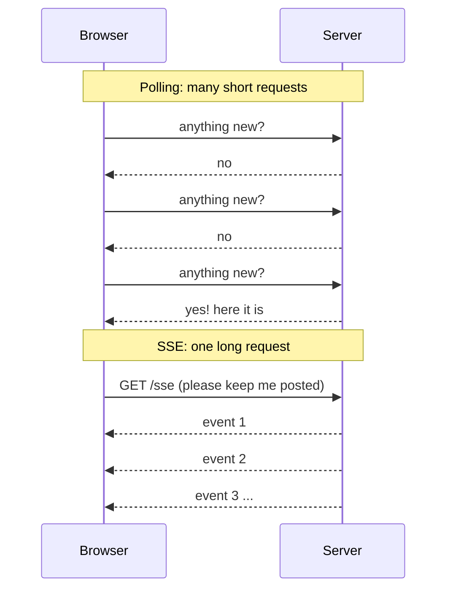
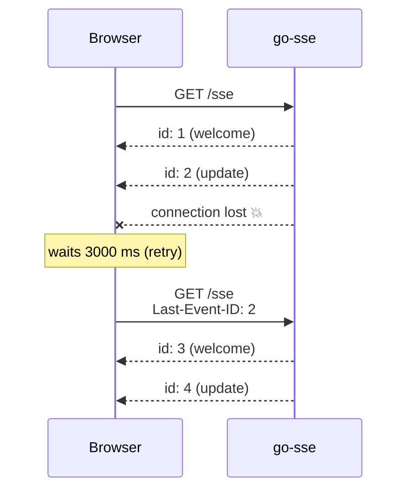

# 1. Server-Sent Events in plain words

## The radio analogy

Think of a **radio station**:

- You tune in **once** (open a connection).
- The station keeps **talking to you** whenever it has news.
- You **cannot talk back** through the radio — if you want to call the station, you use the phone (a normal HTTP request).
- If the signal drops, your radio **tunes in again automatically**.

That is exactly **Server-Sent Events (SSE)**: a browser opens one long HTTP request and the server keeps writing messages into it.

## Why not just ask again and again? (polling)

Without SSE, a page that wants fresh data has to ask the server every few seconds, like a child in the back seat asking *"are we there yet?"*. Most answers are *"not yet"* — wasted trips.



## SSE vs WebSockets

| | SSE | WebSockets |
|---|-----|-----------|
| Direction | server → browser only | both directions |
| Protocol | plain HTTP | its own protocol after an HTTP "upgrade" |
| Reconnection | **automatic**, built into the browser | you write it yourself |
| Data | text (we send JSON) | text or binary |
| Best for | dashboards, notifications, progress bars, feeds | chats, games, collaborative editing |

Rule of thumb: if the browser mostly **listens**, SSE is simpler.

## What travels on the wire

The response has three important headers:

```http
HTTP/1.1 200 OK
Content-Type: text/event-stream   <- "this is an SSE stream"
Cache-Control: no-cache           <- never cache live data
Connection: keep-alive            <- do not close the connection
```

Then the body is plain text. Each message is a few `field: value` lines followed by **an empty line** (the empty line means "message finished"):

```text
retry: 3000
id: 1
event: welcome
data: {"message":"Connected to go-sse Server-Sent Events","client_id":"01a1..."}

id: 2
event: update
data: {"message":"Server update #1","cpu_usage":26,"memory_usage":41,"connections":1}

```

| Field | Meaning |
|-------|---------|
| `id` | A number for the message. The browser remembers the last one. |
| `event` | The message type. The browser can listen to each type separately. |
| `data` | The content. go-sse sends JSON. |
| `retry` | How many milliseconds to wait before reconnecting if the connection drops. |
| `: text` | A comment, ignored by the browser. |

## Automatic reconnection with `Last-Event-ID`

When the connection drops, the browser waits `retry` milliseconds and reconnects, sending the header `Last-Event-ID: <last id it saw>`. go-sse reads that header and **continues counting from there**, like a podcast app that remembers where you stopped.



## The browser side

Browsers have a built-in class called `EventSource`:

```javascript
const source = new EventSource("/sse");
source.addEventListener("update", (e) => {
  const data = JSON.parse(e.data);
  console.log(data.cpu_usage);
});
```

That is all you need — no library.

## References

- [HTML Living Standard – Server-Sent Events](https://html.spec.whatwg.org/multipage/server-sent-events.html)
- [MDN – Using server-sent events](https://developer.mozilla.org/en-US/docs/Web/API/Server-sent_events/Using_server-sent_events)

Next: [Architecture →](02-architecture.md)
