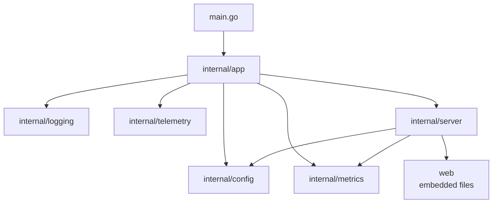
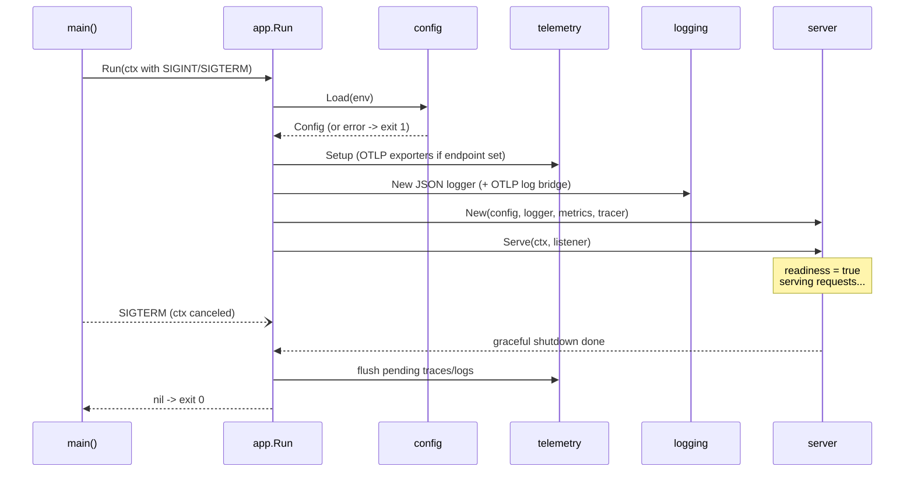
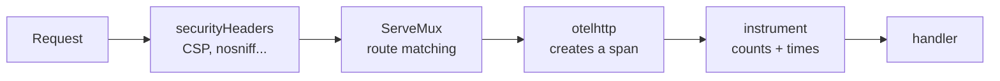

# 2. Architecture

## The restaurant analogy

go-sse is organized like a small **restaurant**:

| Restaurant | go-sse | Go package |
|------------|--------|-----------|
| The manager who opens the doors in the morning and closes them at night | Starts everything and shuts it down cleanly | `internal/app` |
| The house rules on the wall (opening hours, menu) | Configuration from environment variables | `internal/config` |
| The waiter who serves the tables | HTTP routes and the SSE stream | `internal/server` |
| The order counter that tallies how many dishes were served | Prometheus metrics | `internal/metrics` |
| The diary where staff write what happened | JSON logs | `internal/logging` |
| The security camera recording each order's path through the kitchen | OpenTelemetry traces | `internal/telemetry` |
| The menu and the decoration | HTML, CSS, JavaScript (embedded in the binary) | `web` |
| The front door | `main()` | `main.go` |

## Repository layout

```text
go-sse/
├── Makefile, mise.toml, scripts/   # developer machine setup (check-deps / install-deps)
├── docs/                           # you are here
├── app/                            # the Go application (versioned in app/Makefile + CHANGELOG)
│   ├── main.go                     # tiny: wires signals and calls app.Run
│   ├── internal/
│   │   ├── app/        # startup + shutdown orchestration, -healthcheck flag
│   │   ├── config/     # environment variables -> Config struct
│   │   ├── logging/    # slog JSON logger (+ trace_id correlation)
│   │   ├── telemetry/  # OpenTelemetry tracer/logger providers (OTLP/HTTP)
│   │   ├── metrics/    # Prometheus registry and collectors
│   │   └── server/     # routes, SSE handler, health checks, middleware
│   ├── web/            # templates/ + static/ embedded with go:embed
│   ├── dashboard/      # Grafana dashboard (generated by generate.py)
│   ├── observability/  # configs for Collector, Prometheus, Loki, Tempo, Grafana
│   ├── Dockerfile
│   └── docker-compose.yaml
└── helm-chart/                     # Kubernetes deployment (Helm 4, versioned in Chart.yaml)
```

> **Why `internal/`?** Go forbids other modules from importing packages under `internal/`. It is a "staff only" sign: these packages are implementation details of this app.

## How the packages depend on each other

Arrows mean "uses". Notice that nothing points back to `app`: the manager knows everybody, but the staff do not depend on the manager. This makes each package easy to test alone.



## Startup sequence



## HTTP routes

Go 1.22+ `http.ServeMux` understands methods and exact matches, so no router library is needed.

| Pattern | Handler | Traced | Purpose |
|---------|---------|--------|---------|
| `GET /{$}` | `handleIndex` | yes | The web page. `{$}` means *exactly* `/` — unknown paths return 404 |
| `GET /static/` | file server | no | CSS, JS, favicon (embedded) |
| `GET /sse` | `handleSSE` | yes | The event stream |
| `GET /health` | `handleHealth` | no | Human-friendly status (version, uptime, connections) |
| `GET /livez` | `handleLive` | no | Liveness probe |
| `GET /readyz` | `handleReady` | no | Readiness probe (503 while starting/stopping) |
| `GET /metrics` | Prometheus | no | Metrics scrape endpoint |

Every route is wrapped by middlewares — think of them as **layers of an onion** the request passes through:



## Design choices worth noticing

- **Dependency injection instead of globals.** The server receives its logger, metrics and tracer in `server.Options`. Tests pass fakes (e.g. an in-memory span recorder).
- **One Prometheus registry per app instance**, not the global one. Tests create a fresh registry each time, so they never collide.
- **`go:embed`** puts HTML/CSS/JS inside the binary: the Docker image only contains one file and the app runs from any directory.
- **Atomic counters** (`atomic.Int64`, `atomic.Bool`) for the connection count and readiness flag — safe for many goroutines without locks.
- **Modern Go (1.27)**: `encoding/json/v2`, the standard `uuid` package, `slog`, `http.ResponseController`, `context.AfterFunc`, `time.Tick`. See [Development workflow](08-development.md#modern-go-guidelines).

Next: [Life of an SSE connection →](03-sse-lifecycle.md)
