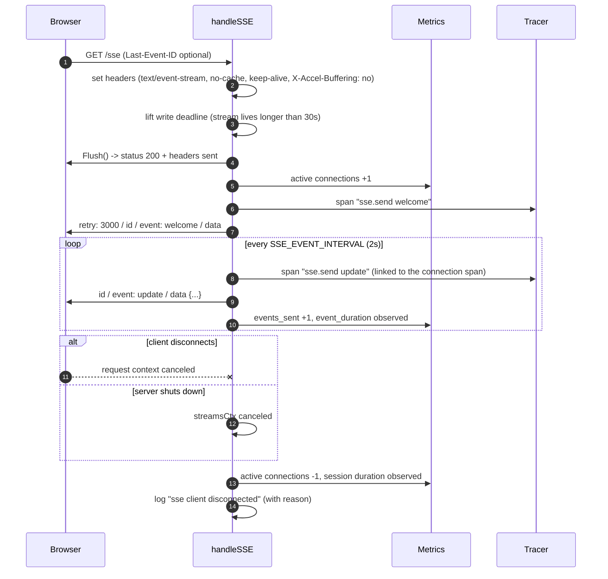
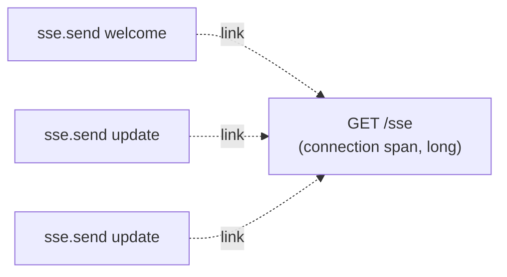
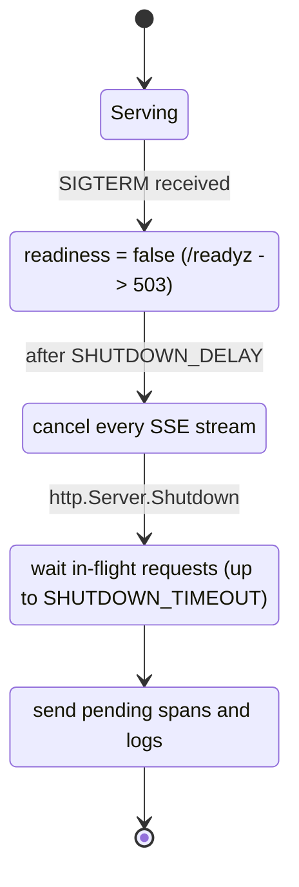

# 3. Life of an SSE connection

This page follows one browser from the moment you click **Connect SSE** until the connection ends. The code lives in [`app/internal/server/sse.go`](../app/internal/server/sse.go).

## The phone call analogy

An SSE connection is like a **phone call where only the server speaks**:

1. You dial (`GET /sse`).
2. The server picks up and says hello (`welcome` event).
3. Every 2 seconds it reads you the news (`update` events).
4. The call ends when **you hang up** (close the tab / click Disconnect) **or the server closes for the night** (shutdown).

## Step by step



## The important pieces of code

### 1. Flushing — "push the words out of your mouth"

Go buffers what you write to make networking efficient. For SSE we want each event to leave **immediately**, so after every event we call `Flush()`:

```go
rc := http.NewResponseController(w)
// ...write the event...
if err := rc.Flush(); err != nil { /* client is gone */ }
```

`http.ResponseController` also finds the real connection behind middleware wrappers (they implement `Unwrap()`).

### 2. One write per event

`writeEvent` builds the whole message in memory and writes it **once**. If the write fails, the client is gone and the handler returns — no goroutine is left behind.

```go
buf = fmt.Appendf(buf, "id: %d\nevent: %s\ndata: %s\n\n", e.ID, e.Name, data)
_, err = w.Write(buf)
```

### 3. Two reasons to stop, one context

The handler must stop when **the client leaves** *or* **the server shuts down**. `http.Server.Shutdown` does not cancel running requests, so go-sse keeps a separate "closing time" context and joins both:

```go
ctx, cancel := context.WithCancel(r.Context())   // canceled when the client leaves
defer cancel()
defer context.AfterFunc(s.streamsCtx, cancel)()  // ...or when shutdown starts
```

Then the main loop simply waits on whichever happens first:

```go
tick := time.Tick(s.cfg.EventInterval)
for seq := 1; ; seq++ {
    select {
    case <-ctx.Done():   // client gone OR shutting down
        return
    case now := <-tick:  // time for the next update
        // send update...
    }
}
```

> **Bug fixed in 2.0.0:** the old version started a helper goroutine that sent on an unbuffered channel; when a write failed the handler returned and that goroutine stayed blocked forever (a *goroutine leak*). Selecting directly on `ctx.Done()` removes the helper entirely.

### 4. Each event gets its own small trace

A connection can stay open for hours. If every event were a child of the connection span, the trace would only be exported when the connection closed. Instead each event starts a **new root span with a link** to the connection span — small traces you can see immediately in Tempo/Jaeger.



## Graceful shutdown

When Kubernetes (or `Ctrl+C`) sends `SIGTERM`:



Browsers that were connected simply reconnect (after `retry: 3000` ms) to another healthy replica, continuing from their `Last-Event-ID`.

Next: [Observability →](04-observability.md)
