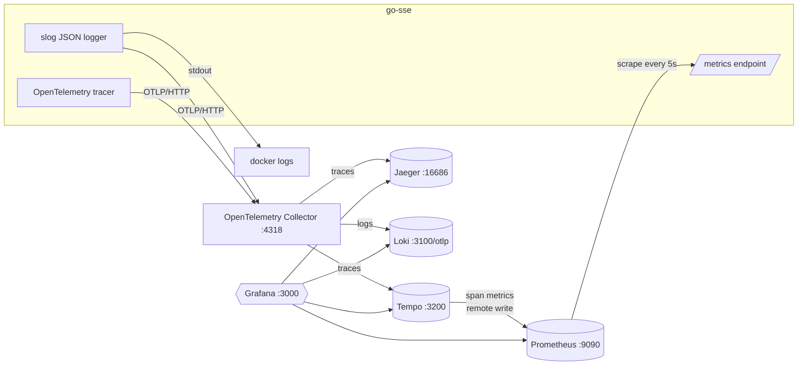
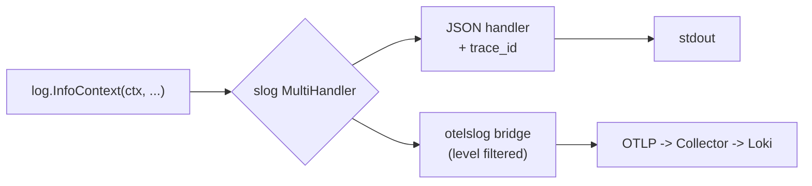
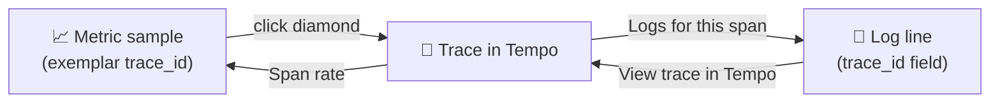

# 4. Observability: metrics, logs and traces

## The car analogy

Imagine you are driving a car:

| Signal | Car | go-sse | Tool |
|--------|-----|--------|------|
| **Metrics** | the dashboard gauges: speed, fuel, temperature | numbers over time: connections, events/s, latency | Prometheus |
| **Logs** | the trip diary: "10:02 stopped for gas" | one JSON line per thing that happened | Loki |
| **Traces** | the GPS route of one specific trip, stop by stop | the path of one request/event through the code, with timings | Tempo, Jaeger |

Metrics tell you **that** something is wrong, logs tell you **what** happened, traces tell you **where** the time went. Grafana is the **windshield** where you look at all of them together, and the three are **linked** by the `trace_id`.

## How the data flows (docker-compose)



Start it with:

```bash
cd app
make compose-up            # = docker compose up -d --build
```

| Service | URL | Image |
|---------|-----|-------|
| go-sse | http://localhost:8080 | built locally |
| Grafana | http://localhost:3000 (admin/admin) | `grafana/grafana:13.3.1` |
| Prometheus | http://localhost:9090 | `prom/prometheus:v3.16.0` |
| Jaeger UI | http://localhost:16686 | `jaegertracing/jaeger:2.23.0` |
| Tempo API | http://localhost:3200 | `grafana/tempo:3.1.1` |
| Loki API | http://localhost:3100 | `grafana/loki:3.7.10` |
| OTel Collector | :4317 (gRPC), :4318 (HTTP) | `otel/opentelemetry-collector-contrib:0.165.0` |

All Grafana data sources and the **go-sse** dashboard are provisioned automatically (folder *go-sse*).

## Metrics (Prometheus)

Prometheus works like a **meter reader** who visits every 5 seconds and writes down the numbers shown at `/metrics`.

| Metric | Type | Labels | Meaning |
|--------|------|--------|---------|
| `sse_http_requests_total` | counter | `path`, `method` | HTTP requests received |
| `sse_http_request_duration_seconds` | histogram | `path`, `method`, `code` | request latency (SSE streams excluded) |
| `sse_active_connections` | gauge | `endpoint` | open SSE streams now |
| `sse_events_sent_total` | counter | `event_type` | events sent (`welcome`, `update`) |
| `sse_event_duration_seconds` | histogram | `event_type` | time to encode + write + flush one event |
| `sse_session_duration_seconds` | histogram | – | how long clients stayed connected |
| `sse_build_info` | gauge | `version`, `goversion` | always 1; tells which version runs |
| `go_*`, `process_*` | various | – | Go runtime and process stats |

- **Counter** = an odometer: only goes up. Use `rate()` to get "per second".
- **Gauge** = a speedometer: goes up and down.
- **Histogram** = buckets of "how many took less than X". Use `histogram_quantile()` for p50/p95/p99.

**Exemplars**: when a histogram is observed inside a sampled span, go-sse attaches the `trace_id` to the sample. In Grafana these appear as small diamonds on the latency graphs — click one to jump to the exact trace. (This needs the OpenMetrics format, enabled on `/metrics`, and Prometheus `--enable-feature=exemplar-storage`.)

Useful PromQL:

```promql
sum(sse_active_connections)
sum by (event_type) (rate(sse_events_sent_total[5m]))
histogram_quantile(0.95, sum by (le, path) (rate(sse_http_request_duration_seconds_bucket[5m])))
```

## Logs (JSON + Loki)

Every log line is one JSON object on stdout:

```json
{"time":"2026-11-16T17:00:39.244Z","level":"INFO","msg":"sse client connected",
 "service":"go-sse","version":"2.0.0","client_id":"01a1e54d-...","remote_addr":"172.19.0.1:52380",
 "trace_id":"92b19d6e7d6414f9775cd34c69aeb84f","span_id":"eb019e7519803cb4"}
```

- **Level** is controlled by `LOG_LEVEL` (`DEBUG`, `INFO` — default —, `WARN`, `ERROR`). With `DEBUG` you also get one line per event sent.
- **`trace_id` / `span_id`** are added automatically when the log is written inside a request: this is the bridge from logs to traces.
- Logs go to **two places** through `slog.NewMultiHandler`: stdout (for `docker logs`, `kubectl logs`, Alloy/Promtail) and, when OTLP is enabled, the OpenTelemetry Collector → Loki.



In Loki, logs are labeled `service_name="go-sse"` and Loki adds `detected_level` (`debug`, `info`, `warn`, `error`). Useful LogQL:

```logql
{service_name="go-sse"}
{service_name="go-sse"} | detected_level="error"
sum by (detected_level) (count_over_time({service_name="go-sse"}[1m]))
{service_name="go-sse"} | json | msg="sse client disconnected"   # stdout JSON collected by Alloy/Promtail
```

## Traces (OpenTelemetry → Tempo and Jaeger)

A **trace** is the story of one operation; each chapter is a **span** with a start, an end and attributes.

| Span | Created by | Notes |
|------|-----------|-------|
| `GET /` | `otelhttp` middleware | page loads |
| `GET /sse` | `otelhttp` middleware | the whole connection (ends on disconnect) |
| `sse.send welcome` / `sse.send update` | `sendEvent` | one small trace per event, **linked** to the connection span; attributes `sse.event.type`, `sse.event.id`, `sse.client.id` |

Health checks, static files and `/metrics` are **not** traced (they would only add noise).

Tracing is enabled when `OTEL_EXPORTER_OTLP_ENDPOINT` (or the traces/logs specific variants) is set and `OTEL_SDK_DISABLED` is not `true`. All [standard OTEL_* variables](https://opentelemetry.io/docs/specs/otel/configuration/sdk-environment-variables/) work (headers, timeouts, resource attributes...).

Tempo also turns spans into metrics (**metrics-generator**: `traces_spanmetrics_*`, `traces_service_graph_*`) and pushes them to Prometheus — that powers the "Traces" row of the dashboard and the service graph in Explore.

## Correlation: jumping between signals



These links are configured in [`observability/grafana/provisioning/datasources/datasources.yaml`](../app/observability/grafana/provisioning/datasources/datasources.yaml).

## The Grafana dashboard

[`app/dashboard/go-sse-dashboard.json`](../app/dashboard/go-sse-dashboard.json) is **generated** by [`app/dashboard/generate.py`](../app/dashboard/generate.py) (`make dashboard`). Rows:

1. **Overview** – connections, events/s, requests/s, 5xx ratio, error log count, version.
2. **Metrics (Prometheus)** – request rate and latency (with exemplars), connections, events, event and session durations, Go runtime.
3. **Logs (Loki)** – volume by level, application logs (filter by level and free text), warnings & errors.
4. **Traces (Tempo)** – span rate and latency per operation, recent traces, error traces, service graph rate.

Data sources are dashboard variables, so the same JSON works in any Grafana (it is also shipped by the Helm chart as a ConfigMap with `grafanaDashboard.enabled=true`). See [`app/dashboard/README.md`](../app/dashboard/README.md).

## In Kubernetes

- **Metrics**: enable `serviceMonitor.enabled=true` (Prometheus Operator).
- **Logs**: JSON on stdout is collected by your agent (Grafana Alloy, Promtail, OTel Collector `filelog`), or set `otel.enabled=true` to push them via OTLP.
- **Traces**: `otel.enabled=true` and `otel.endpoint=http://<collector>:4318`.

Next: [Configuration →](05-configuration.md)
