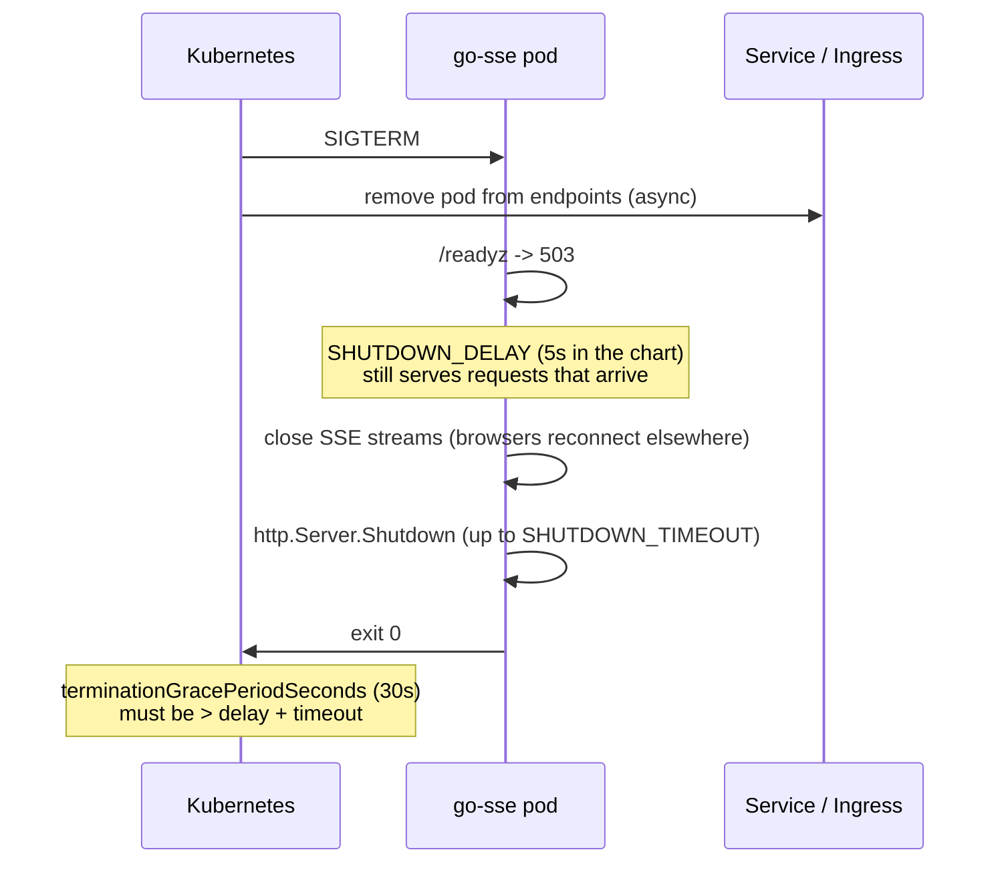
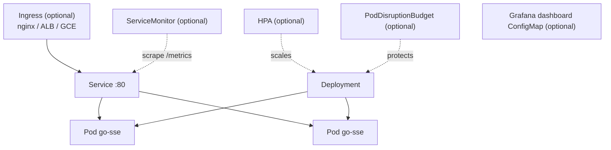

# 6. Health checks and Kubernetes

## The hospital analogy

Kubernetes is like a **hospital nurse** checking on patients (pods):

| Probe | Nurse's question | go-sse endpoint | If it fails... |
|-------|------------------|-----------------|----------------|
| **Startup** | "Have you woken up yet?" | `GET /livez` | keep waiting (up to 60s), then restart |
| **Liveness** | "Are you alive?" | `GET /livez` | **restart** the container |
| **Readiness** | "Can you receive visitors?" | `GET /readyz` | **stop sending traffic** (no restart) |

`/health` is for humans: it returns version, uptime and active connections.

```bash
$ curl -s localhost:8080/health
{"status":"ok","service":"go-sse","version":"2.0.0","uptime_seconds":29.782,"active_connections":1}
$ curl -s localhost:8080/livez
{"status":"ok"}
$ curl -s localhost:8080/readyz
{"status":"ready"}          # 503 {"status":"not_ready"} while starting or shutting down
```

## Why readiness turns off *before* the server stops

When a pod is deleted, Kubernetes sends `SIGTERM` **and at the same time** removes the pod from the Service endpoints. These two things race: for a few seconds, load balancers may still send new requests to a pod that is closing. go-sse handles it like a shop at closing time — **flip the sign to "closed", wait a moment, then lock the door**:



## Helm chart (Helm 4)

The chart lives in [`helm-chart/`](../helm-chart/) and **requires Helm 4** (Helm 3 is no longer supported). `make install` checks the Helm version before doing anything.

```bash
cd helm-chart
make lint          # helm lint --strict (Helm 4 in Docker)
make template      # render manifests locally
make install       # helm upgrade --install go-sse . -n go-sse --create-namespace --wait
kubectl -n go-sse port-forward svc/go-sse 8080:80
```

What the chart deploys:



Main values (full list in [`helm-chart/README.md`](../helm-chart/README.md)):

| Value | Default | Description |
|-------|---------|-------------|
| `logLevel` | `INFO` | Application log level |
| `otel.enabled` / `otel.endpoint` | `false` / `""` | Export traces and logs via OTLP |
| `startupProbe.path`, `livenessProbe.path`, `readinessProbe.path` | `/livez`, `/livez`, `/readyz` | Probe endpoints |
| `shutdown.delay` / `shutdown.timeout` | `5s` / `15s` | Graceful shutdown tuning |
| `serviceMonitor.enabled` | `false` | Prometheus Operator scraping |
| `grafanaDashboard.enabled` | `false` | Ship the Grafana dashboard as a ConfigMap (sidecar label `grafana_dashboard: "1"`) |
| `podSecurityContext` / `securityContext` | hardened | non-root (UID 10001), read-only root FS, no capabilities, seccomp `RuntimeDefault` |

## SSE behind proxies

Long-lived streams need a few proxy settings:

- go-sse sends `X-Accel-Buffering: no`, which tells **ingress-nginx** not to buffer the stream.
- Increase proxy read timeouts (e.g. ingress-nginx `nginx.ingress.kubernetes.io/proxy-read-timeout: "3600"`), or the proxy will cut idle-looking connections. The browser reconnects automatically anyway.
- On GKE, raise the BackendConfig `timeoutSec` (the chart can create it with `service.createGcpBackendAndFrontendConfig`).

Next: [Frontend and theming →](07-frontend.md)
