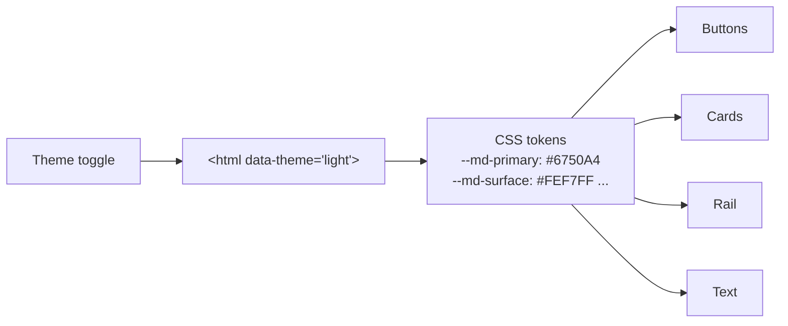
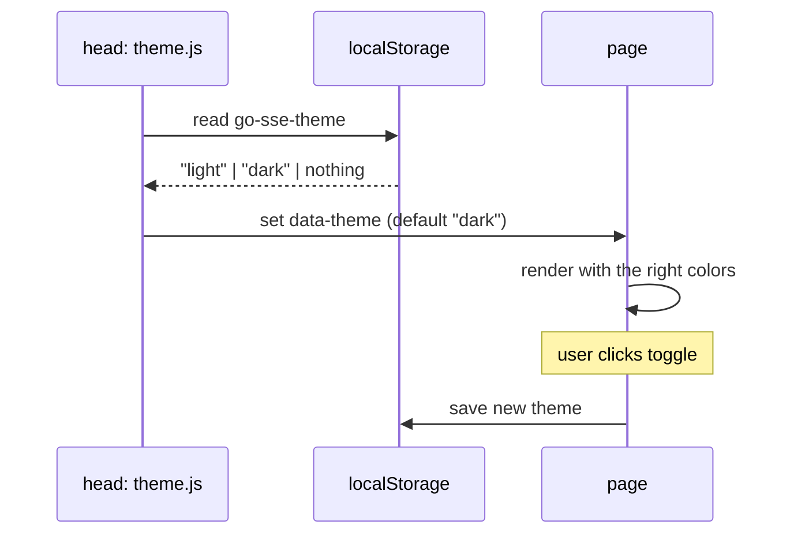

# 7. Frontend and theming

The web page is plain HTML, CSS and JavaScript — **no framework, no build step**. The files are in [`app/web/`](../app/web/) and are embedded into the Go binary with `go:embed`.

| File | Role |
|------|------|
| `templates/index.html` | Page structure (Go `html/template`, receives the version) |
| `static/theme.js` | Applies the saved theme **before** the page is drawn |
| `static/app.js` | `EventSource` connection, live metrics, event list, theme toggle |
| `static/style.css` | Material Design 3 tokens, components and responsive layout |
| `static/favicon.svg` | Tab icon |

## Material Design 3

The look follows [Material Design 3](https://m3.material.io/) (the same visual language as the M3 documentation site):

- **Navigation rail** on the left (icons + labels, pill-shaped active indicator), **navigation drawer** with the page sections, theme toggle at the bottom.
- **Large hero card** with `display-large` typography and 28px rounded corners.
- **Pill buttons**: *filled* (primary action), *tonal* (secondary), *outlined*.
- **Cards**, **chips**, a **switch** and **state layers** (a translucent overlay on hover/press).

### Design tokens — the "paint cans" analogy

Instead of writing colors everywhere, the CSS defines named **paint cans** once (`--md-primary`, `--md-surface`, `--md-on-surface`...) and every component uses the can names. Switching theme just **swaps the content of the cans**:

The values are the M3 **baseline** color scheme:

| Token | Dark (default) | Light |
|-------|---------------|-------|
| `--md-primary` | `#D0BCFF` | `#6750A4` |
| `--md-secondary-container` | `#4A4458` | `#E8DEF8` |
| `--md-surface` | `#141218` | `#FEF7FF` |
| `--md-surface-container` | `#211F26` | `#F3EDF7` |
| `--md-on-surface` | `#E6E0E9` | `#1D1B20` |

Typography uses the M3 type scale (`display-large` 57/64, `headline-small` 24/32, `title-large` 22/28, `label-large` 14/20 ...) with Google Sans / Roboto.

## Dark and light mode

- **Dark is the default.**
- The toggle button (sun in dark mode, moon in light mode) saves the choice in `localStorage` under `go-sse-theme`.
- `theme.js` runs synchronously in `<head>`, so the page never "flashes" the wrong theme on load.
- If storage is blocked (private mode), the toggle still works for the current page.

## Security in the browser

- Events are rendered with `textContent`, never `innerHTML` — data from the stream can never inject HTML/JS (**XSS** protection).
- The server sends a **Content-Security-Policy** that only allows scripts from the same origin and fonts from Google Fonts, plus `X-Content-Type-Options`, `X-Frame-Options` and `Referrer-Policy`.

## Responsive layout

| Width | Layout |
|-------|--------|
| > 1024px | rail + drawer + content |
| 601–1024px | rail + content |
| ≤ 600px | content + bottom navigation bar |

Next: [Development workflow →](08-development.md)
