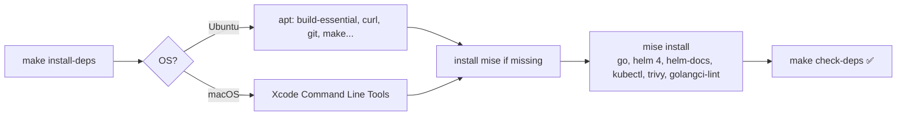

# 8. Development workflow

## Supported machines

| OS | Versions | Architectures |
|----|----------|---------------|
| Ubuntu | 22.04, 24.04, 26.04 | amd64 |
| macOS | current releases | amd64 (Intel), arm64 (Apple Silicon) |

## Installing the tools

Tool versions are pinned in [`mise.toml`](../mise.toml) and installed with [mise](https://mise.jdx.dev) — think of mise as a **toolbox with labeled slots**: every project says which exact screwdriver it needs, and mise hands you that one when you are inside the project folder.

```bash
make install-deps   # apt (Ubuntu) / Xcode CLT (macOS) + mise + every tool in mise.toml
make check-deps     # verifies everything (exit code 1 if something is missing)
```

Docker and Docker Compose are **installed separately** — see [REQUIREMENTS.md](../REQUIREMENTS.md).



## Everyday commands (`cd app`)

| Command | What it does |
|---------|--------------|
| `make run` | build and run locally (`LOG_LEVEL=debug make run`) |
| `make test` | unit tests with `-race`, coverage report, **fails below 90%** |
| `make coverage-html` | open the coverage report in the browser |
| `make lint` | `golangci-lint` (config in `app/.golangci.yml`) |
| `make fmt` / `make vet` | format / static checks |
| `make image-build` | build the Docker image |
| `make scan` | Trivy vulnerability scan of the image (fails on fixable HIGH/CRITICAL) |
| `make compose-up` / `compose-down` | full observability stack |
| `make update-deps` | update Go dependencies |
| `make dashboard` | regenerate the Grafana dashboard JSON (and copy it to the chart) |

## Tests

Tests sit next to the code (`*_test.go`) and use only the standard library plus small helpers from Prometheus and OpenTelemetry. Some techniques used — useful patterns to learn:

| Technique | Where | Why |
|-----------|-------|-----|
| **Table-driven tests** | `config_test.go` | many inputs, one loop |
| **`httptest.NewServer`** | `server_test.go` | real HTTP + real SSE stream, no network setup |
| **Fake `ResponseWriter`s** | `server_test.go` | simulate "streaming not supported" and "broken pipe" |
| **In-memory span recorder** (`tracetest`) | `server_test.go` | assert spans and links without Tempo |
| **Fake OTLP collector** | `telemetry_test.go` | check that traces and logs are really exported |
| **Injected env / writers** | `app_test.go` | run the whole app in-process |
| **Re-executing the test binary** | `main_test.go` | test `main()` and its exit code |
| **`t.Context()`, `t.Setenv`** | everywhere | automatic cleanup |

Coverage goal: **≥ 90%** (currently ~97%). `make test` enforces it.

## Modern Go guidelines

When creating, reviewing or testing Go code in this repo, use the [Modern Go Guidelines](https://github.com/JetBrains/go-modern-guidelines) (also registered in [`CLAUDE.md`](../CLAUDE.md) for AI assistants). Examples applied here for Go 1.27:

| Guideline | In go-sse |
|-----------|-----------|
| `encoding/json/v2` for new JSON code | SSE payloads, health responses |
| standard `uuid` package | SSE `client_id` (`uuid.NewV7()`) |
| `slog` structured logging, `slog.NewMultiHandler` | `internal/logging` |
| typed atomics (`atomic.Int64`, `atomic.Bool`) | connection count, readiness |
| `context.AfterFunc` | stop streams on shutdown |
| method-aware `ServeMux` patterns (`GET /{$}`) | routes |
| `cmp.Or`, `errors.Join`, `fmt.Appendf`, `time.Tick`, `for range n` | config, SSE writer, tests |
| `t.Context()` | tests |

## Security scanning with Trivy

```bash
cd app
make image-build scan
```

The image is based on Alpine 3.24 with `apk upgrade`, runs as a non-root user and contains a single static binary. You can also scan the chart and Dockerfile for misconfigurations:

```bash
trivy config helm-chart/
trivy config app/Dockerfile
```

## Releasing

- **App**: bump `VERSION` in `app/Makefile` (also used as the image tag), the `VERSION` build arg/image tag in `app/docker-compose.yaml`, and add an entry to `app/CHANGELOG.md`.
- **Chart**: bump `version` (and `appVersion` if needed) in `helm-chart/Chart.yaml`, run `make gen-docs`.

See [CONTRIBUTING.md](../CONTRIBUTING.md) for the fork/branch/PR workflow.
