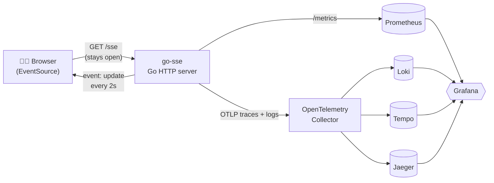

# go-sse documentation

Welcome! These pages explain **what go-sse does and how it is built**, written for programmers who are just getting started with Go, web protocols or observability. Each page uses everyday analogies and diagrams (rendered by GitHub with [Mermaid](https://mermaid.js.org/)).

## Suggested reading order

| # | Page | You will learn |
|---|------|----------------|
| 1 | [Server-Sent Events in plain words](01-sse-concepts.md) | What SSE is, how it differs from polling and WebSockets |
| 2 | [Architecture](02-architecture.md) | The folders, Go packages and how they fit together |
| 3 | [Life of an SSE connection](03-sse-lifecycle.md) | Step by step: from the "Connect" button to the shutdown |
| 4 | [Observability: metrics, logs and traces](04-observability.md) | Prometheus, Loki, Tempo, Jaeger, OpenTelemetry and Grafana |
| 5 | [Configuration](05-configuration.md) | Every environment variable and its default |
| 6 | [Health checks and Kubernetes](06-kubernetes.md) | `/livez`, `/readyz`, probes, graceful shutdown and the Helm chart |
| 7 | [Frontend and theming](07-frontend.md) | The browser code, Material Design 3 and dark/light mode |
| 8 | [Development workflow](08-development.md) | Installing tools, tests, coverage, linting and Trivy |

## The big picture in one diagram



## Quick start

```bash
make install-deps         # Go, Helm 4, Trivy... via mise (Docker is installed separately)
cd app
make compose-up           # app + full observability stack
# App:      http://localhost:8080
# Grafana:  http://localhost:3000 (admin/admin) -> Dashboards -> go-sse
```
